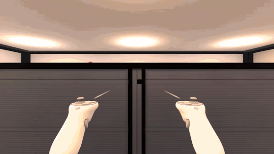
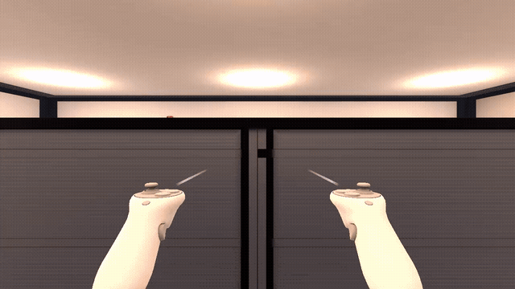

# NEUROSHELF

**A VR simulation that measures how in-store marketing shapes what you buy — then shows you your own data.**

Unity 6.3 LTS · URP · OpenXR · C#

---

## Why

Advertising techniques work precisely because people do not notice them. Being told about them rarely changes behaviour — the listener agrees in theory and keeps responding to the same cues in practice.

NEUROSHELF closes that gap by putting the participant under the influence first, in controlled conditions, and showing them the recording afterwards. The output is their own effect size, not someone's opinion.

---

## How it works

| Phase | What happens | What is recorded |
|---|---|---|
| **A — Naive run** | Shopping from a list on a fixed budget. Manipulations active; participant not told. | Gaze dwell time, path, pickups and returns, basket total, impulse share |
| **B — Debrief** | A separate analytics room replays the route, lights a gaze heatmap on the shelves, annotates every purchase with the technique that drove it. | — |
| **C — Aware run** | Same store, manipulations disabled: neutral planogram, honest price tags, no scarcity timers. | Same metrics, compared against Phase A |

---

## Techniques modelled

Each is an independent module, toggled through an experiment-condition asset. Conditions are data, not code.

| Technique | Implementation | Evidence |
|---|---|---|
| Eye-level placement | Target brand at the 160 cm tier, competitors at 60 cm | Chandon et al. (2009) · Drèze et al. (1994) |
| Shelf facings | 4 facings for the target brand vs 1 for the competitor | Chandon et al. (2009) |
| Price anchoring | Struck-through reference price beside the actual price | Tversky & Kahneman (1974) |
| Decoy effect | Three sizes where the middle exists only to sell the largest | Huber, Payne & Puto (1982) |
| Scarcity & urgency | "3 left" tags, countdown timers on promo stands | Worchel, Lee & Adewole (1975) |
| Social proof | NPC shoppers cluster at the promoted shelf | Cialdini (1984) |
| Music priming | Background soundtrack on/off and tempo are fields of the experiment condition | North, Hargreaves & McKendrick (1999) · Milliman (1982) |
| Spatial sound anchor | A jingle at a chosen shelf, occluded by the racks; time to first approach is logged per shelf | — (hypothesis tested here) |
| Mere exposure | Brand logo shown *N* times before the shelf is reached | Zajonc (1968) |
| Lighting accent | Warm 3000K over impulse zone, cold 5000K over markdowns | Experimental variable |

---

## Known limitations

Stated plainly, because this is a measurement instrument and its boundaries matter.

- **No true eye tracking.** Head direction is recorded as a coarse proxy. A participant can move their eyes without turning their head — the metric is *head-gaze*, not eye-gaze.
- **No olfactory channel.** Scent marketing cannot be reproduced in VR.
- **No physiological signals.** EEG and GSR are out of scope, though the analytics layer is event-driven and accepts additional sources without modification.
- **Locomotion bias.** Teleport removes the walk to distant shelves; smooth locomotion keeps it but risks motion sickness. Neither reproduces real walking, so the mode is recorded as a factor and distance is logged in parts — the comparison estimates the bias, it does not remove it.
- **Headset-free development.** Built and tested on the XR Device Simulator; see below for the calibration this required.

---

## Scene

Built at real-world scale — 1 unit = 1 metre. The proportions are the experiment, not decoration.

| Element | Dimensions |
|---|---|
| Sales floor | 12 × 8 × 3 m |
| Shelf unit (×4) | 2.4 × 0.6 × 1.8 m |
| Shelf tiers | **0.60 m** requires bending · **1.10 m** mid · **1.60 m** eye level |
| Aisle between rows | 2.4 m clear — room-scale turning space |
| Checkout counter | 2 × 1.1 × 0.8 m |
| Player spawn | (0, 0, −3.2), facing the sales floor |

---

## Texture atlas

A single 2048×2048 atlas on a 4×4 grid carries the entire product range plus four environment materials — one material for everything on the shelves.

| # | Content | # | Content |
|---|---|---|---|
| 0–3 | Metal · Plastic · Wood · Floor tile | 8–11 | KRISP · NORDA · GRANO · FERRO |
| 4–7 | AURA · VOLTA · NUBO · ZEST | 12–15 | MIRA · OKTA · LUMEN · PURA |

Each cell occupies a 0.25 × 0.25 UV range, giving 512 px per product — enough for the label to read at arm's length, which is as close as anyone gets to a shelf in this scene.

Maps: `Albedo` (sRGB), `Normal`, and `MetallicSmoothness` — metallic in RGB, smoothness in alpha, as URP expects. Separate `Metallic` and `Roughness` maps are kept for documentation.

**All brands are fictional.** No real trademarks are used. Package design is itself an experimental variable: colour, contrast and price-font size affect shelf salience.

---

## Tooling

Editor scripts replace the manual click-work and make every stage reproducible from a menu.

**`NEUROSHELF_Blender_LR2.py`** — builds 12 packaging models at real dimensions, runs Smart UV Project with a 0.01 island margin on each, packs every unwrap into its assigned atlas cell by UV arithmetic, and exports a single FBX with a selection filter.

**`NeuroshelfMaterialSetup.cs`** — an Editor menu that sets correct import settings per texture (sRGB for colour, linear for data, Normal Map type, Clamp wrap for atlas safety), builds the URP Lit material, wires the maps into the right slots, applies it across a hierarchy, and reports material and renderer counts for draw-call analysis.

**`NeuroshelfLightingSetup.cs`** — light rig, static flags, lightmap bake on CPU, light probes, before/after renders and an FPS probe.

**`NeuroshelfAnimationSetup.cs`** — Humanoid rigs, vertex-weight verification, Animator Controllers, Two Bone IK promoter, NavMesh shoppers, mesh simplification.

**`NeuroshelfInteractionSetup.cs`** — collision layers, product physics and grab setup, Near-Far hands, shelf and basket sockets, an automated Play Mode scenario with pass/fail checks, and a Unity Recorder capture.

**`NeuroshelfRemote.cs`** — a file-based bridge that lets an external agent run Editor menu items and read the console, so the whole pipeline runs without clicking.

---

## Architecture

```
Assets/_Project/
├── Scenes/         00_Bootstrap · 01_MainMenu · 02_Store · 03_DebriefLab
├── Scripts/
│   ├── Core/           session and phase control
│   ├── Data/           ScriptableObject definitions
│   ├── Interaction/    products, shelves, cart, price tags
│   ├── Manipulation/   one module per technique behind IManipulator
│   ├── Analytics/      gaze, path, purchase logging → CSV export
│   ├── NPC/            shopper agents, IK promoter
│   └── UI/             wrist panel, debrief screens, heatmap
├── Art/            Models · Textures
├── Materials/
├── Prefabs/
└── Configs/        experiment conditions, planograms, product catalogue
```

Two decisions carry the design.

**Experiment conditions live in data, not code.** A condition asset lists which manipulators are active, which planogram to load, which audio and lighting to apply. Switching between the manipulated and neutral runs swaps one asset — no duplicated scenes, no branching logic.

**Analytics is event-driven and one-directional.** The session recorder subscribes to interaction events and never calls back into gameplay. Logging can be removed entirely without affecting the simulation; new data sources attach through the same subscription.

---

## Interaction



*Recorded with Unity Recorder from the shopper's eyes. Poses are scripted (no headset); the grabbing, ray pull, sockets, throw and physics are stock XR Interaction Toolkit components.*

Taking a product off the shelf **is** the recorded decision. The tier heights only become a measurable cost of access once reaching for a product is an action: the 1.60 m tier is a straight reach, the 0.60 m tier requires bending — and the bend shows up in the data as a drop in head height.

| Element | Implementation |
|---|---|
| Hands | **Near-Far Interactor** (XRI 3.3.2) on both controllers: a 0.10 m sphere caster for grabbing by hand, a 6 m curve caster for the ray. Unity positions it as the replacement for the XRI 2.x Direct + Ray pair; one component means no arbitration between two interactors and a single `Near/Far` field in the data |
| Products | 12 × `XR Grab Interactable` with primitive colliders only (Capsule for bottles, Box for cans and cartons) — zero Mesh Colliders in the scene |
| Attach points | Bottle by the neck (85% height), carton by the centre of the front face, can by the body |
| Physics | Mass and drag per packaging: PET bottle 0.53 kg / drag 0.05, can 0.35 kg / 0.05, carton 0.15–0.45 kg / 0.35. Launched identically, the carton lands 0.15 m short of the bottle and stops 1 m sooner |
| Throw | Smoothing 0.20 s, velocity scale **1.0** (XRI default is 1.5): a measurement instrument should not exaggerate throws. Measured: the product leaves at 95–98% of hand speed |
| Basket | 6 socket slots, follows the shopper at waist height, turns only when the body turns > 35°. *Placed in basket = purchased* |
| Shelf slots | Every product sits in its own planogram socket. *Returned to its slot* and *dropped on the floor* are separate events |
| Collision layers | `Products × NPC` disabled; the ray ignores NPCs; both layers excluded from NavMesh baking so a dropped carton never becomes a wall for shoppers |

### Interaction events

`Select Entered` / `Select Exited` on every product feed `ProductInteractionHub` — the extension point the session recorder will subscribe to. Each event carries product ID, tier, hand, near/far, head and hand height, hold time, release speed and outcome:

```
PICK     GRANO  tier=0 (0.60 м) Right from=Shelf via=Near dist=0.04 м head=1.28 м hand=0.76 м
RELEASE  GRANO  tier=0 (0.60 м) Right held=2.42 с … → Purchased
PICK     VOLTA  tier=2 (1.60 м) Right from=Shelf via=Far  dist=1.63 м head=1.65 м hand=1.49 м
RELEASE  VOLTA  tier=2 (1.60 м) Right held=2.64 с … → Returned
RELEASE  KRISP  tier=1 (1.10 м) Right held=1.56 с v_item=2.69 м/с v_hand=2.77 м/с → Thrown
```

A methodological note: a ray that can grab the bottom tier erases the cost of bending — the very variable the eye-level effect depends on. Every event records `via=Near/Far`, and each product has an `allowFarGrab` switch (an `IXRSelectFilter`) to disable the ray for clean runs.

Verified in Play Mode by an automated scenario: **19 of 19 checks pass**. Median frame with all interaction active: 6.82 ms (147 FPS) on Intel Arc integrated graphics.

---

## Locomotion



*Recorded with Unity Recorder from the shopper's eyes at a 90° vertical field of view. Poses and stick input are scripted (no headset); moving, turning, teleporting, collision and the vignette are stock XR Interaction Toolkit 3.3.2 components.*

Here locomotion is not a comfort setting: it is part of the measurement, and a source of bias. The shopper's route — distance walked, time at each shelf, order of visits — is a recorded metric, and the way people move changes it:

- **Teleport** removes the walk to the far shelf. A product there becomes as accessible as one nearby, and part of the placement effect (the cost of access) disappears.
- **Smooth locomotion** keeps distance real but can cause motion sickness, and a sick participant no longer behaves like a shopper.

So both are implemented, and the choice is an experimental parameter rather than a preference. A `LocomotionProfileSO` asset sets mode, speed, turn type and vignette strength, and its name is written into every route file. The design becomes 2 × 2: shelf condition (A / C) × locomotion mode. Comparing the modes on distance and dwell time is itself a result: it shows how much the navigation method distorts the measurement.

| Element | Implementation |
|---|---|
| Teleport | `Teleport Interactor` with a Projectile curve, v = 8.5 m/s, g = 9.8 m/s²: maximum range 8.4 m from hand height, inside the 12 × 8 m hall (the XRI default v = 16 reaches 27 m and makes aiming uncontrollable) |
| Landing rule | Floor only. A target is valid only if it lies on the **NavMesh already baked for the shopper agents** and does not overlap an NPC capsule — no second walkability system. A rejected target turns the curve yellow and the reticle crossed |
| Anchors | One per shelf and one at the checkout, 1.0 m from the shelf edge, landing facing the shelf. Every participant gets the same viewpoint, and all three tiers are in view at once. Anchors are placed clear of the shopper standing spots, so the crowd at the promoted shelf does not lock it for teleporting users |
| Smooth | `ContinuousMoveProvider` at **1.4 m/s**, average adult walking speed, so metres walked stay comparable with a real store |
| Turning | Snap 45° or continuous 60°/s, switchable |
| Vignette | Stock `TunnelingVignetteController`, with aperture driven every frame by a custom `ITunnelingVignetteProvider`: zero at rest, rising with artificial linear (0.1–1.4 m/s) and angular (10–90°/s) speed, capped at 0.70. Head motion in room-scale and instant jumps (teleport, snap) never trigger it |
| Rest frame | The shopping basket, moved into the lower field of view and locked to the XR Origin so it does not lag while walking. A diegetic rest frame instead of an overlaid grid: it does not cover the shelves and does not remind the participant that they are in an experiment |
| Player collider | `CharacterController`, r = 0.25 m, height driven by the camera. It is what keeps the 0.60 m tier costly: without it the shopper simply drives into the shelf (tested — the camera ends up 0.43 m inside) |
| Route log | Head position every 0.2 s, teleport events, zone entry/exit, dwell per shelf; console and CSV. Distance is split into `physical_m` (feet), `smooth_m` (stick) and `teleport_m` (jumped) so the two modes stay comparable |

XRI 3.x renamed the locomotion stack, and most guides still describe 2.x: `LocomotionSystem` → `LocomotionMediator` + `XRBodyTransformer`, `ActionBasedContinuousMoveProvider` → `ContinuousMoveProvider`, `CharacterControllerDriver` → `XRBodyTransformer.useCharacterControllerIfExists`. The 2.x classes are still shipped, marked `[Obsolete]`.

Verified in Play Mode by an automated scenario: **39 of 39 checks pass** — eye height stays at 1.650 m with the collider, measured walking speed 1.400 m/s, vignette thresholds, collision stop at 0.28 m from the shelf edge, valid and rejected teleport targets. Median frame while walking with the vignette: 5.79 ms (173 FPS), 1.7% of frames over the 11.1 ms budget.

Motion sickness itself was **not** measured: there was no headset and no participants. What is verified are objective proxies — the comfort measures fire at the intended thresholds and the frame rate stays within budget.

---

## Running without a headset

No HTC Vive on hand, so the project runs on the **XR Device Simulator** from the XR Interaction Toolkit samples. The interaction logic is real; only the input source is substituted.

Open `Assets/_Project/Scenes/02_Store.unity`, press Play. Keyboard layout must be English.

| Key | Action |
|---|---|
| `Tab` | Cycle: head → left controller → right controller |
| `W A S D`, `Q` / `E` | Move, down / up |
| Right mouse button + mouse | Look |
| Hold `Left Shift` / `Space` | Move the left / right controller with the mouse |
| `G` | Grip — grab and release |
| Left mouse button | Trigger |

### Eye-height calibration

The simulator does not report an anthropometrically correct head height. At XR Origin defaults the eye line landed on the **110 cm** tier — meaning the eye-level effect, the central independent variable of this project, did not reproduce at all.

`Camera Y Offset` is therefore calibrated so the camera's world Y reads **1.65 m** in Play mode, matching the 165–175 cm stature the scene is designed around. Verified by reading the Main Camera's world position, not by eye.

Worth knowing before touching the XR Origin: tier heights are experimental parameters and only mean anything relative to a correct eye height.

---

## Roadmap

| Stage | Scope | Status |
|---|---|---|
| **1** | Environment, blockout geometry, scene hierarchy, XR foundation | ✅ Done |
| **2** | UV pipeline, texture atlas, PBR materials, Editor tooling | ✅ Done |
| **3** | Lighting architecture, lightmap baking, light probes, VR performance budget | ✅ Done |
| **4** | Shopper agents, skeletal animation, procedural IK | ✅ Done |
| **5** | Grab, ray and socket interaction, interaction events | ✅ Done |
| **6** | Teleport and smooth locomotion as an experimental factor, comfort, player collider, route log | ✅ Done |
| **7** | Experiment scenario as a state machine, trigger zones, run-tagged analytics, in-store debrief board | ✅ Done |
| **8** | Spatial audio (Steam Audio HRTF, occlusion, reverb zones), diegetic world-space UI, haptics with an impulse log | ✅ Done |
| 9 | Debrief room as a separate scene, participant study | Next |

Part one — the store as a measurable environment — is complete. Part two turns the interaction events into session data.

---

## Third-party assets

All third-party resources are **CC0**. Attribution is given as a matter of practice, not licence requirement.

[Kenney](https://kenney.nl/assets) · [Quaternius](https://quaternius.itch.io/) · [Poly Haven](https://polyhaven.com/textures) · [ambientCG](https://ambientcg.com/)

Original to this project: all packaging models, the texture atlas and every map in it, label design, and the automation scripts.

**Audio.** Every sound in the store — music, cooler hum, ventilation, footsteps, murmur, checkout, door, UI clicks and the sound anchor — is synthesised by `Tools/synth_audio.py` (numpy/scipy, fixed seeds). No recorded third-party audio is used.

**Spatialiser.** [Steam Audio 4.8.1](https://github.com/ValveSoftware/steam-audio) by Valve, Apache License 2.0 — Windows x64 binaries only, in `Assets/Plugins/SteamAudio/`. Its third-party notices are in `ThirdParty/SteamAudio_THIRDPARTY.md`.

---

## References

1. Chandon, P., Hutchinson, J. W., Bradlow, E. T., & Young, S. H. (2009). Does In-Store Marketing Work? *Journal of Marketing*, 73(6), 1–17.
2. Drèze, X., Hoch, S. J., & Purk, M. E. (1994). Shelf Management and Space Elasticity. *Journal of Retailing*, 70(4), 301–326.
3. Tversky, A., & Kahneman, D. (1974). Judgment under Uncertainty. *Science*, 185(4157), 1124–1131.
4. Huber, J., Payne, J. W., & Puto, C. (1982). Adding Asymmetrically Dominated Alternatives. *Journal of Consumer Research*, 9(1), 90–98.
5. Worchel, S., Lee, J., & Adewole, A. (1975). Effects of supply and demand on ratings of object value. *JPSP*, 32(5), 906–914.
6. North, A. C., Hargreaves, D. J., & McKendrick, J. (1999). The influence of in-store music on wine selections. *Journal of Applied Psychology*, 84(2), 271–276.
7. Zajonc, R. B. (1968). Attitudinal effects of mere exposure. *JPSP*, 9(2, Pt.2), 1–27.
8. Meißner, M., Pfeiffer, J., Pfeiffer, T., & Oppewal, H. (2019). Combining virtual reality and mobile eye tracking for shopper research. *Journal of Business Research*, 100, 445–458.
9. Milliman, R. E. (1982). Using Background Music to Affect the Behavior of Supermarket Shoppers. *Journal of Marketing*, 46(3), 86–91.
10. Blauert, J. (1997). *Spatial Hearing: The Psychophysics of Human Sound Localization*. MIT Press.
